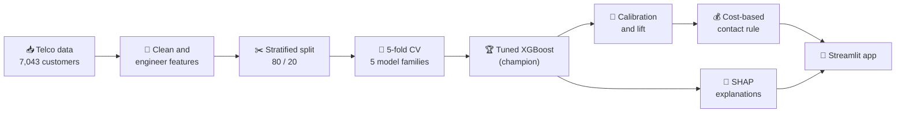
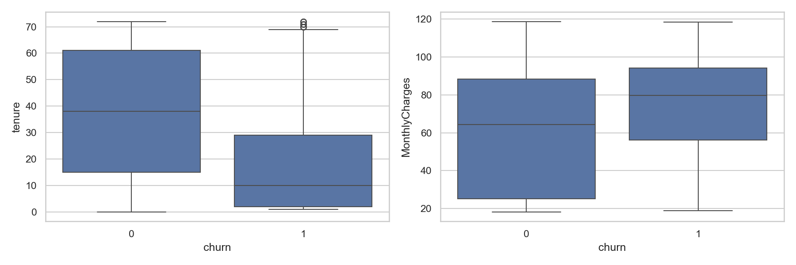
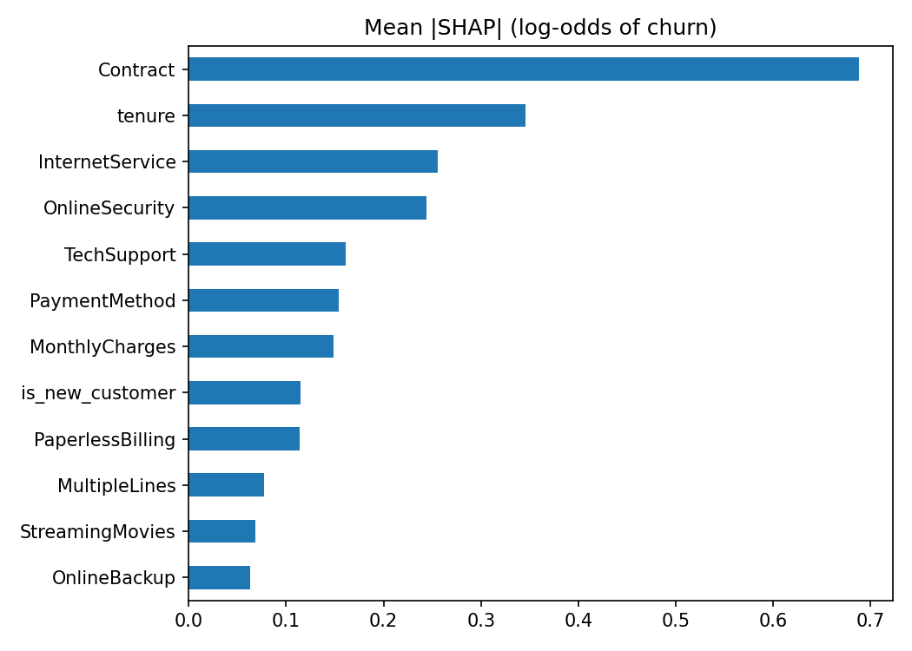
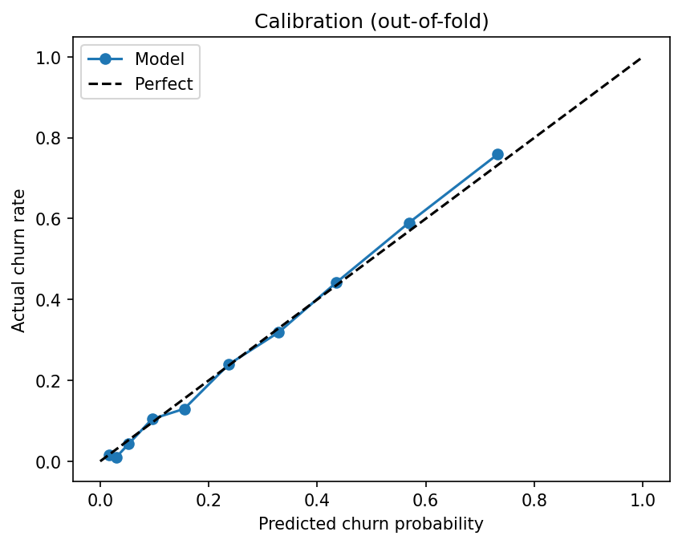
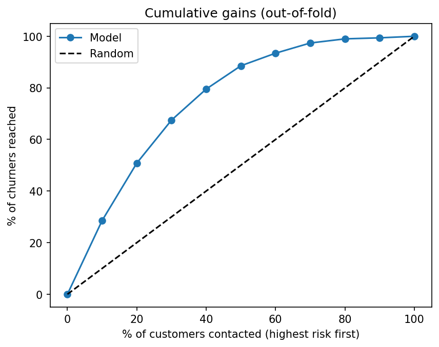
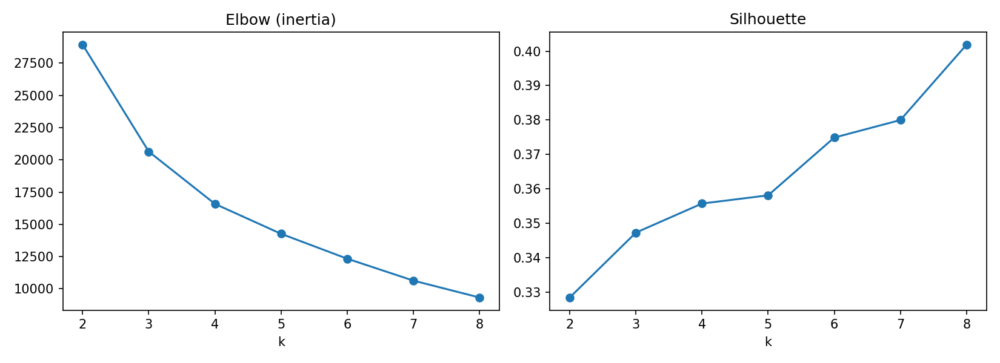
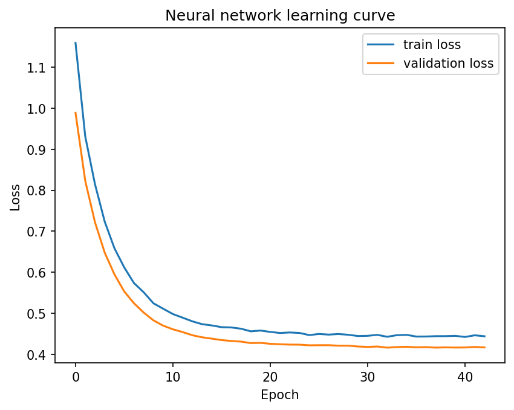

<h1 align="center">📉 Customer Retention Analytics</h1>

<p align="center">
  
  
  
  
  
  
</p>

<p align="center">
  <b>Who is about to leave, why, and is it worth trying to keep them?</b><br>
  An end-to-end churn project on real telecom data: modelling, business-cost decisions, explainability and a Streamlit app.
</p>

<p align="center">
  <a href="#-at-a-glance">At a glance</a> •
  <a href="#-the-app">App</a> •
  <a href="#-approach">Approach</a> •
  <a href="#-results">Results</a> •
  <a href="#-business-impact">Business impact</a> •
  <a href="#-run-it">Run it</a>
</p>

<!-- Add your deployed link when ready:
<p align="center"><a href="YOUR_STREAMLIT_URL"></a></p>
-->

---

## ✨ At a Glance

| 👥 Customers | 📉 Churn rate | 🎯 Best ROC-AUC | 🔍 Top driver | 💰 Decision rule |
|:---:|:---:|:---:|:---:|:---:|
| **7,043** | **26.5%** | **≈ 0.85** | **Contract type** | **Cost-based, not a 0.5 cut-off** |

**The problem.** Keeping a customer is usually cheaper than winning a new one, but retention offers cost money too. A churn model is only useful if it tells a team *who to contact* and *whether it pays off*.

**What this project does.**
- Predicts churn with a leakage-safe pipeline, compared across five model families using 5-fold cross-validation
- Turns probabilities into a **dollar-based contact decision** instead of a default 0.5 threshold
- Explains each prediction with **SHAP** and suggests a retention action
- Groups customers into **four segments** and checks calibration and lift
- Serves everything through an interactive **Streamlit app**

---

## 📱 The App

Enter a customer (or load a real held-out one) and get:

| | |
|---|---|
| 📊 **Churn probability** | calibrated, with a High / Medium / Low band |
| 🧩 **Segment** | for example "New fiber, month-to-month" |
| 💵 **Expected benefit of contacting** | probability × offer success rate × 12 months of revenue − offer cost |
| 🔎 **Why** | SHAP chart of the top drivers for that customer |
| ✅ **Recommended action** | picked from the customer's own risk drivers, or "do not contact" |

The sidebar lets you change the offer success rate and cost, so you can watch the decision flip.

```bash
streamlit run app/app.py
```

---

## 🗂️ Dataset

**IBM Telco Customer Churn**, a public sample dataset: 7,043 customers, 21 columns, 1,869 churners (26.5%).

It has no session or login logs, so *engagement* is approximated from real columns:

| Engineered feature | Built from |
|---|---|
| `addon_count` | number of the six add-on services a customer has |
| `has_support_addons` | tech support or online security |
| `streaming_flag` | streaming TV or movies |
| `is_new_customer` | tenure of 12 months or less |

> [!NOTE]
> These are **proxies** for engagement, not usage data. `TotalCharges` was dropped (about 0.83 correlated with tenure, no CV gain), and the 11 blank values belonged to brand-new customers who had not been billed yet.

---

## 🧭 Approach



**Leakage controls:** the scaler and encoder live inside a `Pipeline` and are fitted on training folds only. Models and hyper-parameters are chosen with cross-validation, and the test set is used once at the end.

---

## 📊 Results

5-fold stratified cross-validation on the training set:

| Model | ROC-AUC | PR-AUC |
|---|:---:|:---:|
| Always predict the average (baseline) | 0.500 | 0.265 |
| Decision tree (depth 5) | 0.830 ± 0.010 | 0.618 |
| Logistic regression (C = 0.1) | 0.846 ± 0.011 | 0.663 |
| Random forest (depth 8) | 0.847 ± 0.008 | 0.661 |
| Neural network (TensorFlow, 32-16) | 0.847 ± 0.012 | 0.662 |
| **XGBoost (tuned)** | **0.850** * | **0.67** * |

<sub>* Re-scored on fresh repeated folds (3 × 5) to avoid tuning bias. On the same folds, logistic regression scored 0.8465. XGBoost beat it in 12 of 15 folds by about 0.003 AUC.</sub>

**Held-out test set:** tuned XGBoost reached ROC-AUC ≈ 0.85 and PR-AUC ≈ 0.66, against ≈ 0.84 and ≈ 0.63 for logistic regression, in line with the CV estimates.

### What stood out

- 🧱 **Four very different model families land at about 0.85 AUC.** The available features, not the algorithm, set the ceiling. A simple logistic regression is nearly as good as the champion.
- 🌳 **A single decision tree shows the bias-variance trade-off:** train AUC keeps climbing with depth while CV AUC peaks at depth 5.
- ⚖️ **Calibration is good:** predicted churn probabilities match observed churn rates, so they can be read as probabilities.
- 🔍 **Contract type is the main driver**, followed by tenure, internet service and online security.
- 🧪 **No billing anomalies:** monthly charges are almost fully explained by the services bought (R² = 0.9988).

<table>
  <tr>
    <td align="center"><br><sub>Tenure and charges by churn</sub></td>
    <td align="center"><br><sub>What drives the predictions (SHAP)</sub></td>
  </tr>
  <tr>
    <td align="center"><br><sub>Calibration (out-of-fold)</sub></td>
    <td align="center"><br><sub>Cumulative gains</sub></td>
  </tr>
  <tr>
    <td align="center"><br><sub>Choosing the number of segments</sub></td>
    <td align="center"><br><sub>Neural network learning curve</sub></td>
  </tr>
</table>

---

## 💰 Business Impact

A churn score is only useful if it drives a decision. Contacting the riskiest customers reaches a large share of churners: roughly the **top 20% by risk captures about half of all churners**.

Net result of each contact strategy on out-of-fold predictions (5,634 customers):

| Strategy | Contacted | Net result |
|---|---:|---:|
| Contact nobody | 0 | $0 |
| Contact everyone | 5,634 | $54,048 |
| Threshold 0.5 | 1,122 | $126,096 |
| Best global threshold (0.19) | 2,818 | $162,846 |
| **Expected-benefit rule** | **2,357** | **$170,966** |

The rule contacts a customer when `probability × success rate × annual revenue > offer cost`. It adapts to each customer's spend and has no tuned threshold.

> [!IMPORTANT]
> The dollar figures use **illustrative assumptions** (25% offer success rate, $50 per contact, a saved customer worth 12 months of revenue), not real company data. The result is very sensitive to them: at a 10% success rate it falls to about $22,000, and with a $100 offer it is close to zero. In practice the success rate should be measured with an A/B test.

---

## 🧩 Customer Segments

K-means (k = 4) on service and tenure features, fitted without using the churn label:

| Segment | Profile | Churn |
|---|---|:---:|
| 📞 No-internet / phone only | low spend, no internet | ≈ 7% |
| 🏆 Loyal power users | long tenure, many add-ons, longer contracts | ≈ 10% |
| 🧭 Mid-value, month-to-month | mid tenure, few add-ons | ≈ 28% |
| 🚨 **New fiber, month-to-month** | fiber, high spend, few support add-ons | **≈ 54%** |

The last segment is the retention priority. An Isolation Forest also flags about 2% of customers as unusual, but they are mostly loyal two-year customers, so "unusual" does not mean "at risk".

---

## 🚀 Run It

```bash
git clone https://github.com/arman-yusufzai/customer-retention.git
cd customer-retention

conda create -n churn-ml python=3.10 -y
conda activate churn-ml
pip install -r requirements.txt

streamlit run app/app.py
```

The app opens at `http://localhost:8501`. To rebuild the models, run the notebooks in order:

<details>
<summary><b>📓 Notebook guide</b></summary>

| Notebook | What it does |
|---|---|
| `01_eda` | Data audit, cleaning decisions, churn drivers |
| `02_features_and_baseline` | Engagement features, split, logistic regression with CV |
| `03_tree_models` | Decision tree, random forest, XGBoost, bias-variance |
| `04_tuning` | Random search and fair fold-by-fold comparison |
| `05_neural_net` | TensorFlow network under the same CV protocol |
| `06_segments_anomalies` | K-means segments, Isolation Forest, pricing check |
| `07_business_layer` | Calibration, lift, cost-based decision |
| `08_final_evaluation` | One-time test evaluation, SHAP, saved model |
| `09_app_assets` | Sample customers for the app |

Reusable code lives in `src/` (`features`, `evaluation`, `nn`, `segments`, `business`, `explain`).

</details>

---

## ⚠️ Limitations

- One public dataset of about 7,000 customers, with no usage logs, so engagement is approximated.
- SHAP shows what the model **uses**, not what **causes** churn. Overlapping features (support add-ons, monthly charges and services) share credit.
- Dollar figures depend on assumed save rates and costs.
- Static snapshot: a production system would need monitoring for drift and periodic retraining.

---

## 🙏 Credits

Dataset: IBM Telco Customer Churn sample data.

<p align="center">
  Built by <a href="https://github.com/arman-yusufzai">arman-yusufzai</a> as an ML internship project · ⭐ if you found it useful
</p>
